<div align="center">

# 💳 Payment — Flutter × Stripe Checkout

**A clean, production-style Flutter checkout flow powered by the Stripe Payment Sheet, built with Clean Architecture and BLoC/Cubit.**


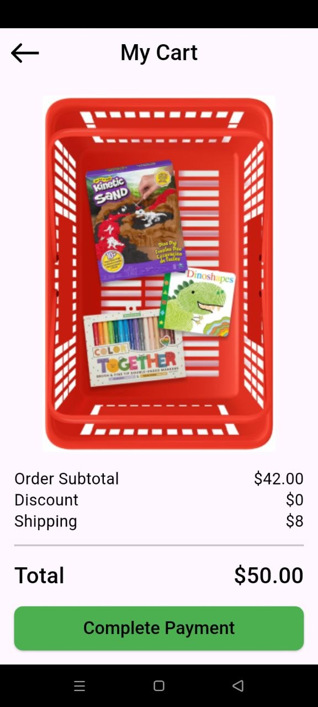

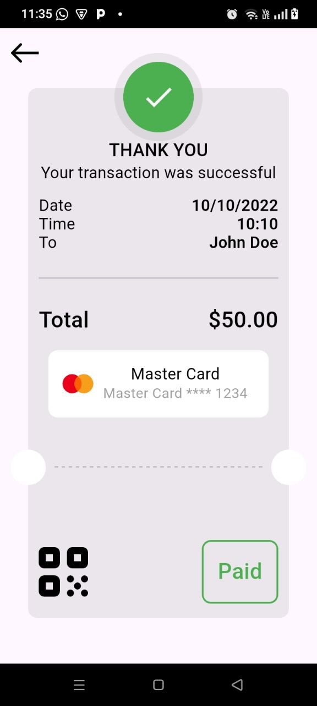

</div>

---

## 📖 Overview

**Payment** is a Flutter app that demonstrates a complete e-commerce checkout: the user reviews a cart, picks a payment method, pays securely through the **Stripe Payment Sheet** (cards, Link, Google Pay, Cash App Pay, Amazon Pay, Bank), and lands on a receipt-style confirmation screen.

It is a great reference for:

- Integrating `flutter_stripe` end-to-end (PaymentIntent → Ephemeral Key → Payment Sheet).
- Structuring a Flutter app with **Clean Architecture** (data / presentation / core layers).
- Handling payment states and errors functionally with **Cubit + `Either` (dartz)**.

> ⚠️ **Test mode only.** The project is intended for learning and prototyping with Stripe **test keys**. See [Security Notes](#-security-notes) before going anywhere near production.

---

## ✨ Features

- 🛒 **Cart screen** with order subtotal, discount, shipping and total.
- 💳 **Stripe Payment Sheet** – a single, PCI-compliant UI for multiple payment methods.
- 🔗 **Stripe Link, Google Pay, Cash App Pay, Amazon Pay & Bank** options (as enabled on your Stripe account).
- 💾 **Saved cards** – returning customers see their saved Visa and can manage/remove it (via Customer + Ephemeral Key).
- ⏳ **Loading, success and failure states** driven by a `PaymentCubit`.
- 🧾 **Animated "Thank You" receipt** – date, time, total, card used, dashed ticket divider, QR code and a "Paid" stamp.
- 🧩 **Custom Payment Details screen** with a live credit-card preview (`flutter_credit_card`) and payment-method selector (Card / PayPal / MasterCard).
- 🚨 **Graceful error handling** – `StripeException` and network errors are mapped to a `Failure` and shown in a `SnackBar`.

---

## 📱 Screenshots

### Checkout flow

| Cart | Choose method | Payment Sheet | Add card |
|:---:|:---:|:---:|:---:|
|  | 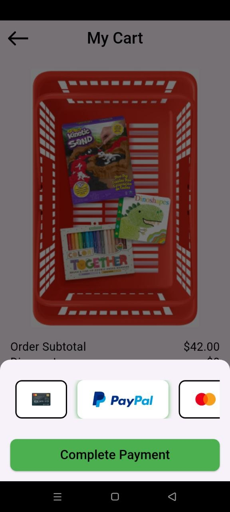 |  | 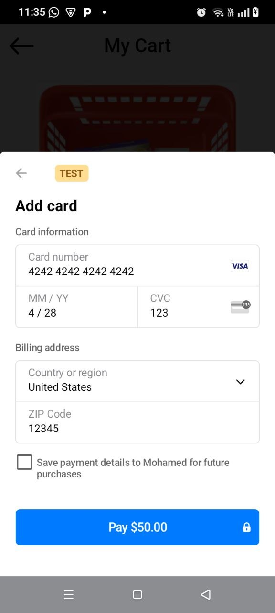 |

| Save card | Processing | Saved card | Manage card |
|:---:|:---:|:---:|:---:|
| 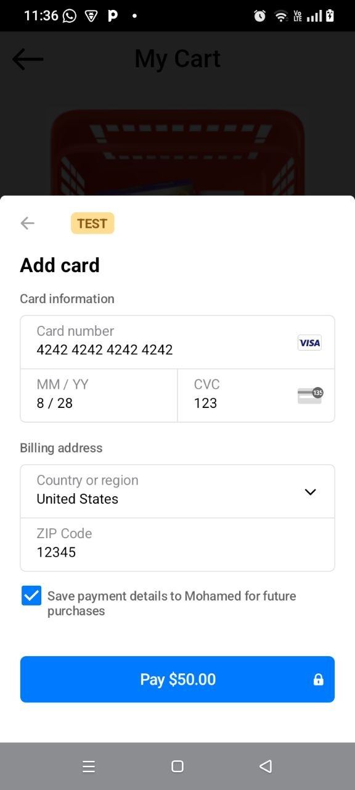 |  | 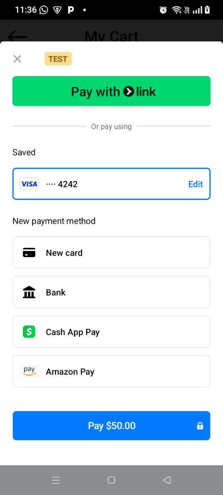 | 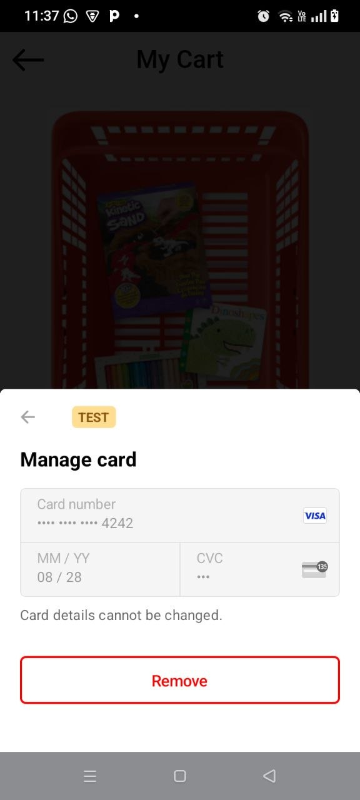 |

### Confirmation

| Thank you | Google Pay prompt |
|:---:|:---:|
|  | 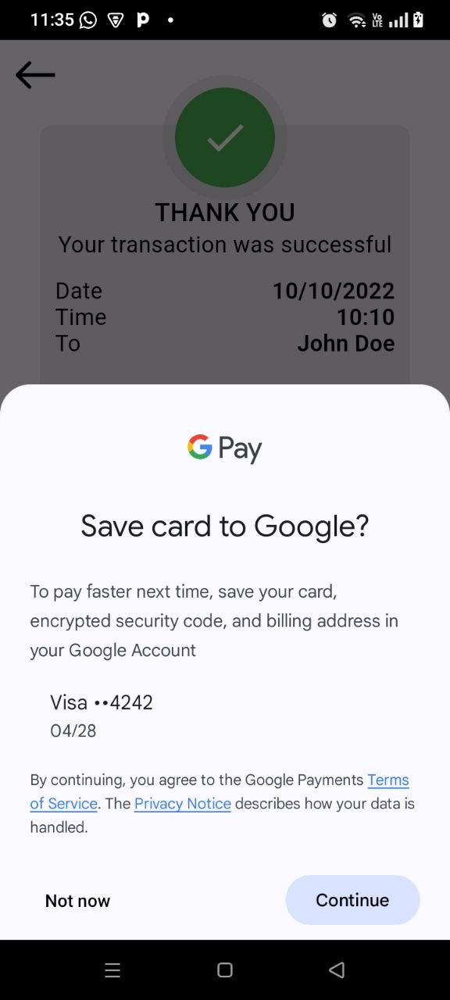 |

### Custom card form

| Empty form | Filled form | Keyboard | CVV flip |
|:---:|:---:|:---:|:---:|
| 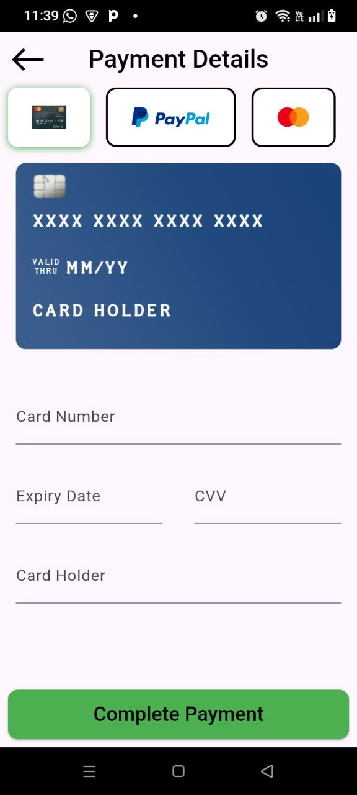 | 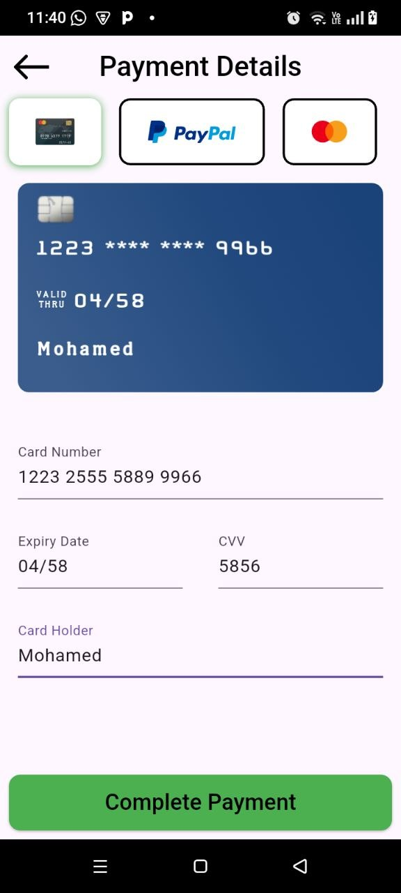 | 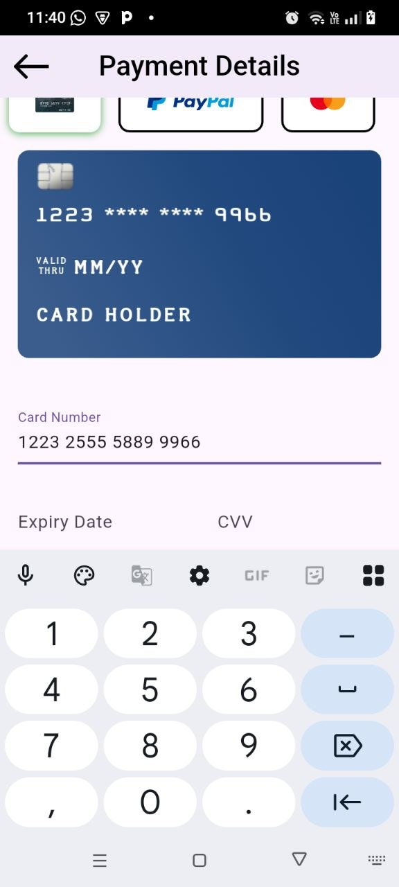 | 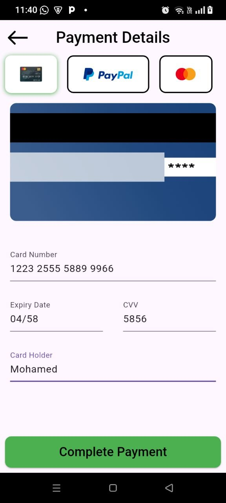 |

<details>
<summary>More screenshots</summary>

<br/>

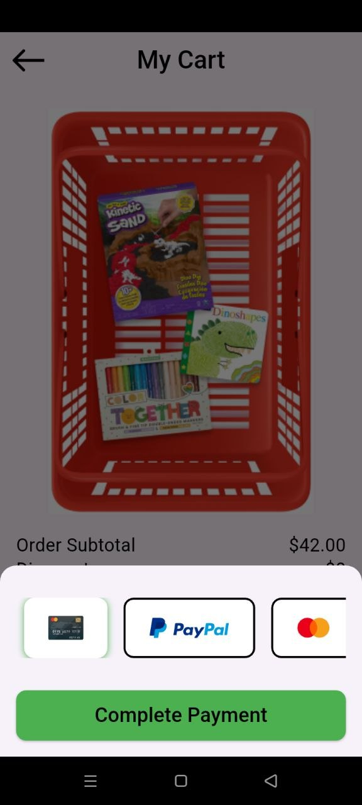
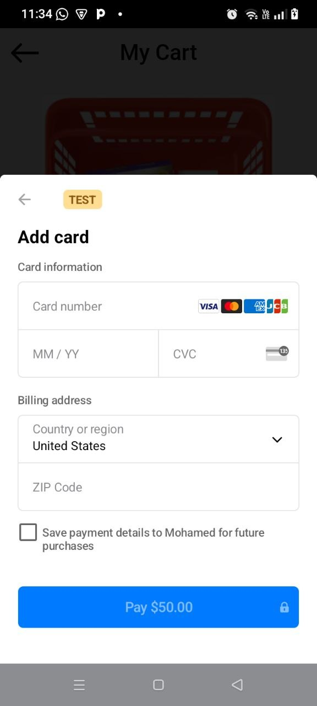
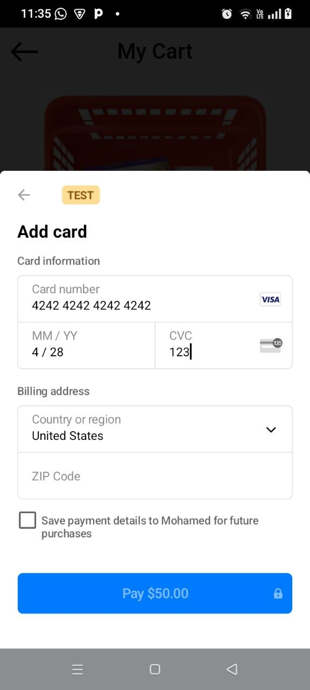
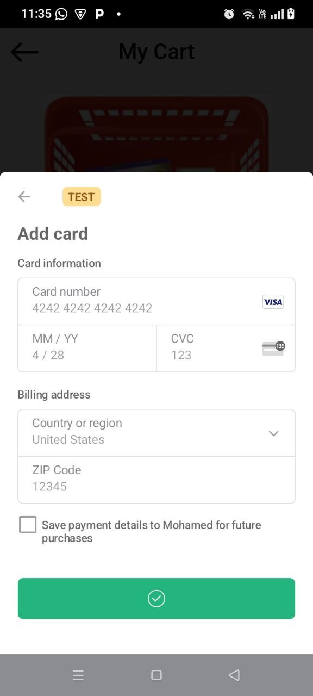
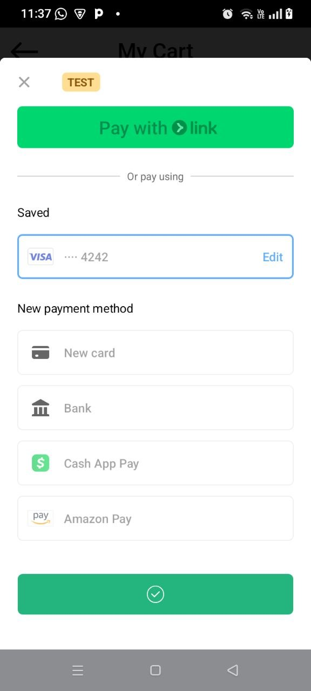
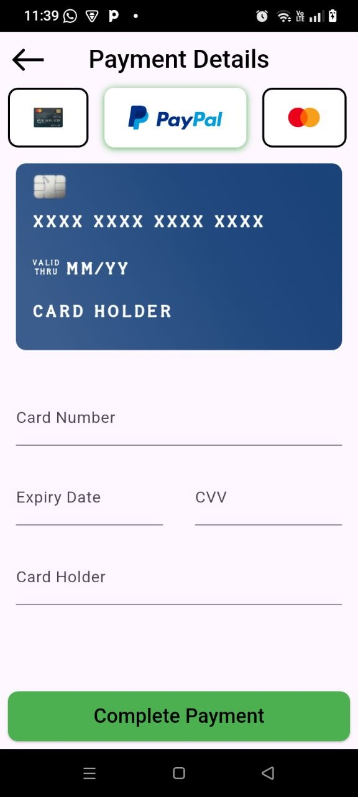

</details>

---

## 🔄 How the Payment Works

```text
 Cart ──► "Complete Payment" ──► Bottom sheet ──► PaymentCubit.makePayment()
                                                        │
                                                        ▼
                                              PaymentRepoImpl
                                                        │
                                                        ▼
                                                 StripeService
        ┌───────────────────────────┬──────────────────────────────────┐
        ▼                           ▼                                  ▼
 1. POST /v1/payment_intents  2. POST /v1/ephemeral_keys     3. initPaymentSheet()
    (amount, currency,           (for the customer)             + presentPaymentSheet()
     customer)
                                                        │
                       ┌────────────────────────────────┴───────┐
                       ▼                                        ▼
               PaymentSuccess ──► ThankYouView          PaymentFailure ──► SnackBar
```

1. The user taps **Complete Payment** and the payment bottom sheet opens.
2. `PaymentCubit` emits `PaymentLoading` and calls the repository.
3. `StripeService` creates a **PaymentIntent** and an **Ephemeral Key** through Stripe's REST API (using `dio`).
4. The Payment Sheet is initialised with the client secret, customer ID and ephemeral key, then presented.
5. On success the app navigates to `ThankYouView`; on failure the sheet closes and an error `SnackBar` is shown.

---

## 🏗️ Architecture

The project follows **Clean Architecture** with a feature-first layout:

```text
lib/
├── main.dart                       # App entry – initialises Stripe
├── core/
│   ├── errors/failure.dart         # Failure / ServerFailure
│   ├── services/api_service.dart   # Dio wrapper for Stripe REST calls
│   └── utils/
│       ├── styles.dart             # Text styles
│       └── api_keys.dart           # 🔒 git-ignored (you create it)
└── features/
    ├── data/
    │   ├── models/                 # PaymentIntent, EphemeralKey, inputs…
    │   ├── repos/                  # PaymentRepo (abstract) + PaymentRepoImpl
    │   └── services/stripe_service.dart
    └── presentation/
        ├── manager/cubit/          # PaymentCubit + PaymentState
        └── views/
            ├── cart_view.dart
            ├── payment_details.dart
            ├── thank_you_view.dart
            └── widgets/            # Reusable UI components
```

| Layer | Responsibility |
|---|---|
| **Presentation** | Views, widgets and `PaymentCubit` (states: `Initial`, `Loading`, `Success`, `Failure`). |
| **Data** | `PaymentRepo` contract, `PaymentRepoImpl`, `StripeService` and JSON models. |
| **Core** | Shared networking (`ApiService`), error types and styling. |

Results are returned as `Either<Failure, void>` (**dartz**), so the UI never deals with raw exceptions.

---

## 🧰 Tech Stack

| Purpose | Package |
|---|---|
| Framework | [Flutter](https://flutter.dev) / Dart `^3.12.0` |
| Payments | [`flutter_stripe`](https://pub.dev/packages/flutter_stripe) `^14.1.0` |
| State management | [`flutter_bloc`](https://pub.dev/packages/flutter_bloc) `^9.1.1` |
| Networking | [`dio`](https://pub.dev/packages/dio) `^5.11.1` |
| Functional error handling | [`dartz`](https://pub.dev/packages/dartz) `^0.10.1` |
| Card UI | [`flutter_credit_card`](https://pub.dev/packages/flutter_credit_card) `^4.1.0` |
| SVG assets | [`flutter_svg`](https://pub.dev/packages/flutter_svg) `^2.3.0` |
| Icons | `font_awesome_flutter`, `cupertino_icons` |

---

## 🚀 Getting Started

### Prerequisites

- [Flutter SDK](https://docs.flutter.dev/get-started/install) with Dart `3.12+`
- Android Studio / Xcode and a device or emulator
- A free [Stripe account](https://dashboard.stripe.com/register) (use **Test mode**)

### 1. Clone & install

```bash
git clone https://github.com/mohamadnafe14-arch/payment.git
cd payment
flutter pub get
```

### 2. Add your Stripe test keys

`lib/core/utils/api_keys.dart` is **git-ignored**, so you must create it yourself:

```dart
// lib/core/utils/api_keys.dart
abstract class ApiKeys {
  static const String publishableKey = 'pk_test_xxxxxxxxxxxxxxxxxxxxxxxx';
  static const String secretKey = 'sk_test_xxxxxxxxxxxxxxxxxxxxxxxx';
}
```

Get both keys from the Stripe Dashboard → **Developers → API keys** (make sure *Test mode* is on).

### 3. Create a Stripe customer

The checkout currently charges a fixed customer. Create one in the Dashboard (**Customers → Add customer**) or via the API, then replace the placeholder ID in
`lib/features/presentation/views/widgets/custom_button_bloc_consumer.dart`:

```dart
PaymentIntentInput(
  amount: "5000",          // in the smallest currency unit (cents) → $50.00
  currency: "usd",
  customer: "cus_XXXXXXXX", // 👈 your Stripe customer ID
)
```

### 4. Run

```bash
flutter run
```

### 🧪 Test cards

| Scenario | Card number | Expiry / CVC / ZIP |
|---|---|---|
| ✅ Success | `4242 4242 4242 4242` | any future date / any 3 digits / any ZIP |
| 🔐 3D Secure | `4000 0025 0000 3155` | any future date / any 3 digits / any ZIP |
| ❌ Declined | `4000 0000 0000 9995` | any future date / any 3 digits / any ZIP |

More at the [Stripe testing docs](https://docs.stripe.com/testing).

---

## 📲 Platform Notes

- **Android** – `MainActivity` already extends `FlutterFragmentActivity` and the app theme uses `Theme.MaterialComponents`, both required by the Stripe SDK. Make sure your `minSdk` and Kotlin/Gradle versions satisfy the [flutter_stripe requirements](https://pub.dev/packages/flutter_stripe).
- **iOS** – run `cd ios && pod install` after `flutter pub get`, and use a recent Xcode.
- Desktop and web folders exist from the Flutter template, but the Stripe Payment Sheet is a **mobile** feature (Android / iOS).

---

## 🔐 Security Notes

This project calls Stripe's REST API **directly from the app using the secret key**. That is convenient for learning and demos, but it is **not safe for production**: anything bundled in a mobile app can be extracted.

For a real app:

1. Move PaymentIntent and Ephemeral Key creation to **your own backend** (Node, Python, Firebase Functions, etc.).
2. Keep only the **publishable key** in the app.
3. Have the app request a `client_secret` / `ephemeralKey` from your server.
4. Never commit keys, and rotate any key that was ever exposed.

---

## 🗺️ Roadmap

- [ ] Move Stripe secret-key calls to a backend service
- [ ] Dynamic cart (add / remove items, live totals)
- [ ] Customer creation per user instead of a hard-coded ID
- [ ] Re-enable the custom **Payment Details** screen alongside the Payment Sheet
- [ ] Real receipt data (date, time, customer, card brand and last 4) on the Thank You screen
- [ ] Unit tests for `PaymentCubit` and `PaymentRepoImpl`
- [ ] Localization & dark mode

---

## 🤝 Contributing

Contributions, issues and feature requests are welcome!

1. Fork the repo
2. Create a branch: `git checkout -b feature/amazing-feature`
3. Commit: `git commit -m "Add amazing feature"`
4. Push: `git push origin feature/amazing-feature`
5. Open a Pull Request

---

## 📄 License

MIT License was added to the project.

---

<div align="center">

Built with ❤️ using Flutter & Stripe by **[@mohamadnafe14-arch](https://github.com/mohamadnafe14-arch)**

⭐ If you found this useful, consider giving the repo a star!

</div>
